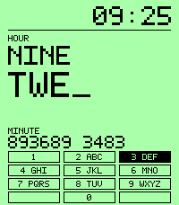
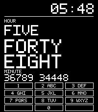
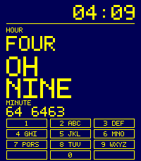
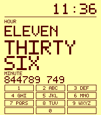

# T9 Time

A Pebble Time 2 watch face that types the current time as T9 text. At each minute change, the numeric clock updates immediately. The keypad then highlights the keys for the hour followed by the minute words. Known collisions briefly show a wrong candidate before the correct word settles.

The face has a 12-hour or 24-hour setting and independent Pebble color pickers for the background and for the digits, words, and keypad. Green with dark ink remains the default. It has no date display or date setting.

## Screenshots

The first frame catches the minute while it is being typed, with an underscore cursor and active T9 key visible. The other frames show alternate color choices on the native 200×228 emery display.






## Build

Requirements: Pebble SDK with emery support, Node.js, and a C compiler for host checks.

```bash
npm install --prefix watchface
python3 execution/build.py
```

The build script runs host checks, cleans the Pebble build, and writes `dist/t9-watch.pbw`. Build diagnostics go to `.tmp/runlog.md`.

## Inspect

```bash
pebble install --emulator emery dist/t9-watch.pbw
pebble screenshot --emulator emery --no-open --no-correction .tmp/emery.png
```

The final layout uses a custom 5×7 pixel alphabet drawn in C. The green LCD concept render guided the composition; the native emery palette and physical watch need separate readability checks.
