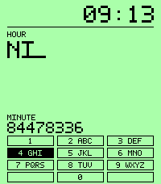
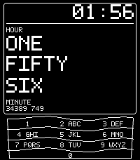

# T9 Time

A Pebble Time 2 watch face that types the current time as T9 text. At each minute change, the numeric clock updates immediately. The keypad then highlights the keys for the hour followed by the minute words. Known collisions briefly show a wrong candidate before the correct word settles.

The face offers 12-hour or 24-hour time, an O'CLOCK or OH ZERO choice at :00, and three display styles: Original (the default), Nokia 3310, and Motorola RAZR V3. The battery icon is optional. Each style has a default palette; turn off **Use model colors** to use the independent background and text color pickers. It has no date display or date setting.

## Screenshots

The first image loops through the hour and minute being typed, with an underscore cursor and active T9 keys. The other images show both phone styles and custom colors on the native 200×228 emery display.






## Build

Requirements: Pebble SDK with emery support, Node.js, and a C compiler for host checks. Pillow 12.3.0 is needed only to regenerate the LCD font header or store GIF.

```bash
npm install --prefix watchface
python3 execution/build.py
```

The build script runs host checks, cleans the Pebble build, and writes `dist/t9-watch.pbw`. Build diagnostics go to `.tmp/runlog.md`.

## Inspect

```bash
pebble install --emulator emery dist/t9-watch.pbw
pebble screenshot --emulator emery --no-open --no-correction .tmp/emery.png
```

The 3310 style uses a bitmap generated from the MIT-licensed [Nokja Original Small Bold](https://webdraft.hu/fonts/nokja-original/) font recreation. Original retains the first-release compact pixel alphabet and square keys. RAZR uses four sweeping keypad separators inspired by its metal keyboard. The native emery palette and physical watch need separate readability checks.
