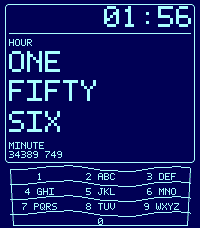
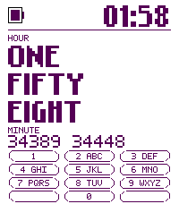
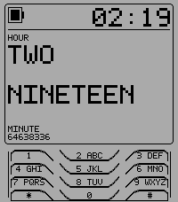

# T9 Time

A Pebble Time 2 watch face that types the current time as T9 text. At each minute change, the numeric clock updates immediately. The keypad then highlights the keys for the hour followed by the minute words. Known collisions briefly show a wrong candidate before the correct word settles.

The face offers 12-hour or 24-hour time, an O'CLOCK or OH ZERO choice at :00, and three display styles: Original (the default), Nokia 3310, and Motorola RAZR V3. The battery icon is optional. Each style has a default palette; turn off **Use model colors** to use the independent background and text color pickers. It has no date display or date setting.

## Screenshots

The first image loops through the hour and minute being typed, with an underscore cursor and active T9 keys. The other images show both phone styles and custom colors on the native 200×228 emery display.






## Build

Requirements: Pebble SDK with emery, chalk, and gabbro support, Node.js, and a C compiler for host checks. Pillow12.3.0 is used by native screenshot QA, font generation, and store GIF tooling.

```bash
npm install --prefix watchface
python3 execution/build.py
```

The build script runs host checks, cleans the Pebble build, and writes `dist/t9-watch.pbw`. Build diagnostics go to `.tmp/runlog.md`.

## Inspect

```bash
pebble install --emulator emery dist/t9-watch.pbw
pebble screenshot --emulator emery --no-open --no-correction .tmp/emery.png
```

The 3310 style uses a bitmap generated from the MIT-licensed [Nokja Original Small Bold](https://webdraft.hu/fonts/nokja-original/) font recreation. Original retains the first-release compact pixel alphabet and square keys. RAZR uses four rows of mirrored outer key outlines and a balanced center key inspired by its metal keyboard. The native emery palette and physical watch need separate readability checks.

Version 0.3.0 adds Quick, Classic, and Slow typing; Off, Occasional, or Every collision guesses; optional quiet hours using the watch clock; and a Silver RAZR model palette. Quiet hours default to 22:00–07:00 when enabled; equal endpoints make the whole day quiet. Occasional minute guesses rotate by hour.



Version 0.3.3 keeps word sizes and baselines fixed while typing. Saving settings replays the current time once, unless quiet hours are active. The RAZR keypad follows connected sculpted rows with larger aligned digits and smaller letter groups.

## T9 Time Labs

The separate experimental face lives in `labs/watchface/`. It has its own UUID and settings storage, so it installs beside stable T9 Time. Build it with `python3 execution/build_labs.py`; the artifact is `dist/t9-time-labs.pbw`. Regular `make build` continues to build stable T9 Time 0.3.3.

Labs contains Time and Weather panes with a full keypad on each. It reads host `weather/location` through the experimental plugin API. Labs contains no separate plugin provider. Weather requires Pebble mobile 1.16.x plugin preview and Location permission. Modes: Classic, Shake, experimental Double-tap, or either. Weather returns after eight seconds. Double-knock modes use opt-in raw accelerometer sampling; physical reliability and battery cost remain unverified.

Labs0.1.1 fixes built-in weather payloads with null or omitted validity, supports text-shaped temperatures, adds High/Normal/Low knock sensitivity, and offers Weather test — show after Save to inspect plugin delivery without a gesture. Double-tap now detects acceleration relative to gravity; High is the default. Field validation remains required.

Labs0.2.0 adds Plugin Peek. Choose a source, reading and item from installed plugins in settings; enable Peek with a double-knock mode. Two knocks show Weather after a700ms third-knock window; three show Peek immediately. Save previews Peek and commits the choice; Cancel preserves the previous choice. Text/numeric/boolean/timestamp readings are supported; images, series and actions are excluded. Missing permissions/providers/items are explicit. Both panes keep the existing keypad and return after8s. Physical and live-mobile validation remain separate from fixture checks.


## Local round-compatible update — 0.3.4

T9 Time includes native layouts for Pebble Time2 (Emery200×228), original Time Round (Chalk180×180), and Round2 (Gabbro260×260). The rectangular layout and existing settings identities are preserved.

Build: `python3 execution/build.py`, then `python3 execution/verify.py`. Local bundle: `dist/t9-watch.pbw`. Native round previews: `media/round/`. Repeatable fixture/capture instructions: [round compatibility QA](knowledge/procedural/round_compatibility.md).

This compatibility update has not been uploaded to the store. Physical-watch validation remains separate from native emulator checks.
